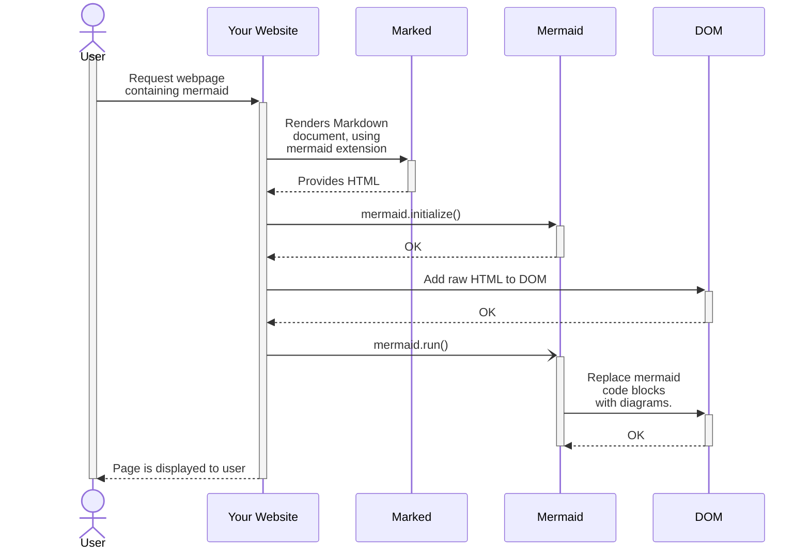
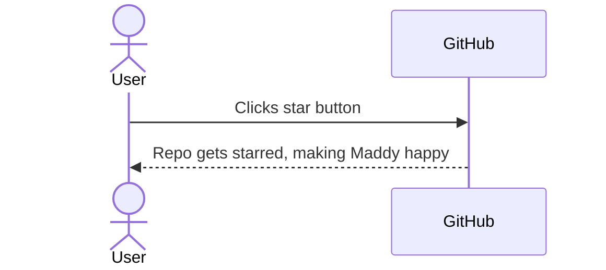

# @MaddyGuthridge/marked-mermaid

A simple Marked extension to render mermaid diagrams.



````md
# Example document



Or, using an alternative (HTML-like) syntax:

<pre class="mermaid">
  sequenceDiagram
    actor User
    User->>GitHub: Clicks star button
    GitHub-->>User: Repo gets starred, making Maddy happy
</pre>
````

<!--
Quadruple backticks for outer code block
https://stackoverflow.com/a/25943045/6335363
-->

Heavily inspired by:

- [marked-mermaid](https://github.com/MichielDeMey/marked-mermaid)
- [dbolack-ab/marked-mermaidjs](https://github.com/dbolack-ab/marked-mermaidjs)

But with up-to-date dependencies (as of November 2025).

- Mermaid 11, 12
- Marked 16-18

Additional notes:

- The diagram will only be rendered in a browser, since the process for
  generating it server-side is [horrific](https://github.com/mermaid-js/mermaid/issues/3650). Maybe this will improve in Mermaid 13.
- As such, this extension won't work nicely with the `marked` CLI.
- You will need to call `mermaid.run()` manually once the page loads, and again
  whenever your document changes.
- This doesn't attempt to do any fancy memoization, which makes the
  implementation much simpler than alternatives. It's still fast enough for
  real-time editing.

## Usage

```sh
npm i @maddyguthridge/marked-mermaid
```

Don't forget the peer dependencies:

```sh
npm i marked mermaid
```

````js
import { Marked } from "marked";
import mermaid from "mermaid";
import markedMermaid from "@maddyguthridge/marked-mermaid";

const marked = new Marked(markedMermaid());

const diagram = [
    "```mermaid",
    "sequenceDiagram",
    "  actor User",
    "  User->>GitHub: Clicks star button",
    "  GitHub-->>User: Repo gets starred, making Maddy happy",
    "```",
].join("\n");

marked.parse(diagram);

// Once running in a browser
mermaid.initialize({});

// Now put the HTML into the DOM

// And then run mermaid's renderer.
// You'll need to repeat this any time more diagrams are added or content is
// changed.
void mermaid.run();
````

## Options

- `enableCodeBlockRender`: whether to convert markdown Mermaid code blocks into
  Mermaid diagrams. Defaults to `true`.
