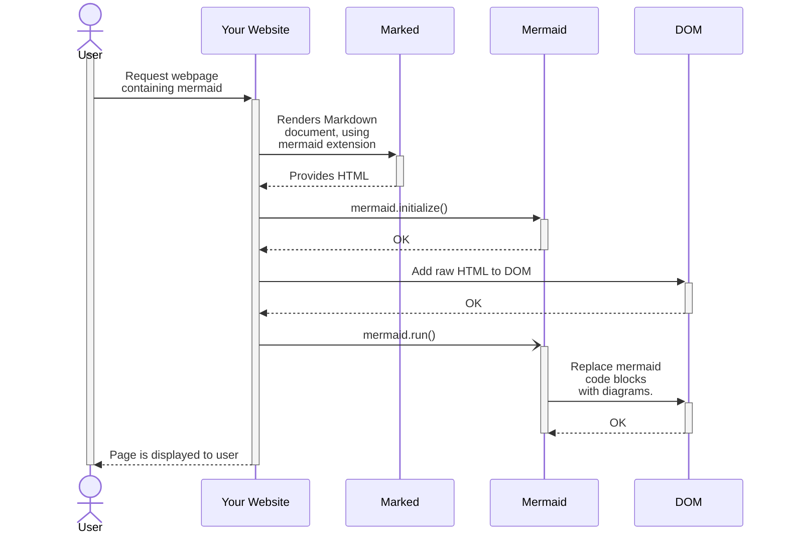

# Example

Or, using an alternative (HTML-like) syntax:

<pre class="mermaid">
sequenceDiagram
    actor User
    User->>GitHub: Clicks star button
    GitHub-->>User: Repo gets starred, making Maddy happy
</pre>
