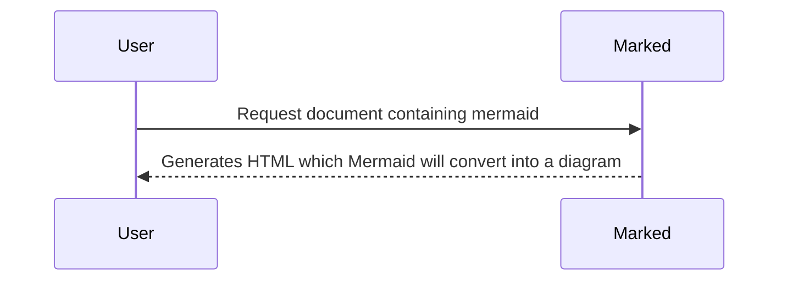

# Example

Or, using an alternative (HTML-like) syntax:

<pre class="mermaid">
  sequenceDiagram
    User->>Marked: Request document containing mermaid
    Marked-->>User: Generates HTML which Mermaid will convert into a diagram
</pre>
